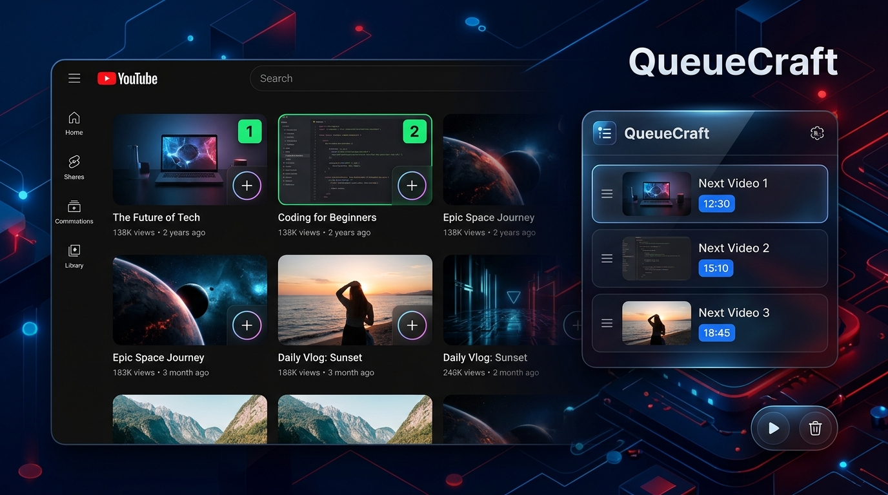

# QueueCraft

<p align="center">
  
</p>

<p align="center">
  <strong>🍿 Lightweight, distraction-free video queue & autoplay extension for YouTube & YouTube Kids.</strong>
</p>

<p align="center">
  <a href="#features">Features</a> •
  <a href="#how-it-works">How It Works</a> •
  <a href="#installation">Installation</a> •
  <a href="#chrome-web-store-deployment">Deploy to Marketplace</a>
</p>

---

## Features

QueueCraft streamlines video queuing on both **regular YouTube** and **YouTube Kids** without altering the native watching experience or cluttering your screen:

- ➕ **One-Click Thumbnail Queuing**: Hover and click the clean `(+)` overlay on any video thumbnail.
- 🔢 **Dynamic Order Badges**: Selected videos highlight with sequential numbered badges (`1`, `2`, `3`...).
- ↕️ **Native Drag-and-Drop Reordering**: Drag video rows in the popup to reorder your playlist effortlessly.
- ⏱️ **Accurate Duration Summing**: Extracts precise durations directly from each video badge and displays the exact total playlist runtime (`~24m`, `~1h 15m`).
- 🎬 **Minimal Floating Dock**: A discreet pill dock (`[ ▶ Play | 3 ] 18m [ ✕ ]`) anchored in the bottom corner that automatically hides during full video playback.
- 🌙 **Session Reset**: The playlist automatically clears when closing your browser or when the machine goes to sleep or locks.
- 🌐 **Full Internationalization (i18n)**: Out-of-the-box support for both **English** (`en`) and **Vietnamese** (`vi`).
- 🧸 **Universal Platform Compatibility**: Smoothly transitions between `youtube.com` and `youtubekids.com`.

---

## How It Works

```
Browse YouTube / Kids ──> Click (+) on Thumbnails ──> [ ▶ Play ] on Dock or Popup ──> Autoplays in sequence
```

1. **Add Videos**: While browsing YouTube or YouTube Kids, click the `(+)` icon on any thumbnail to add it to your queue.
2. **Review & Reorder**: Open the QueueCraft extension popup by clicking its toolbar icon to drag and reorder or remove videos.
3. **Play Sequentially**: Click **Play**, and QueueCraft will progress from one video to the next automatically once each finishes.

---

## Installation (Local Developer Mode)

1. Clone or download this repository:
   ```bash
   git clone https://github.com/pnqphong95/queuecraft.git
   ```
2. Open Google Chrome and go to `chrome://extensions`.
3. Enable **Developer mode** via the switch in the top-right corner.
4. Click **Load unpacked** and select the `queuecraft` folder.
5. Visit [youtube.com](https://www.youtube.com) or [youtubekids.com](https://www.youtubekids.com) and start queuing!

---

## Chrome Web Store Deployment

To package QueueCraft for the Chrome Web Store or Microsoft Edge Add-ons:

```bash
zip -r queuecraft.zip manifest.json background.js content.js content.css popup.html popup.js _locales/ icons/ README.md -x "*.DS_Store*"
```

Upload `queuecraft.zip` to the [Chrome Developer Dashboard](https://chrome.google.com/webstore/devconsole).
